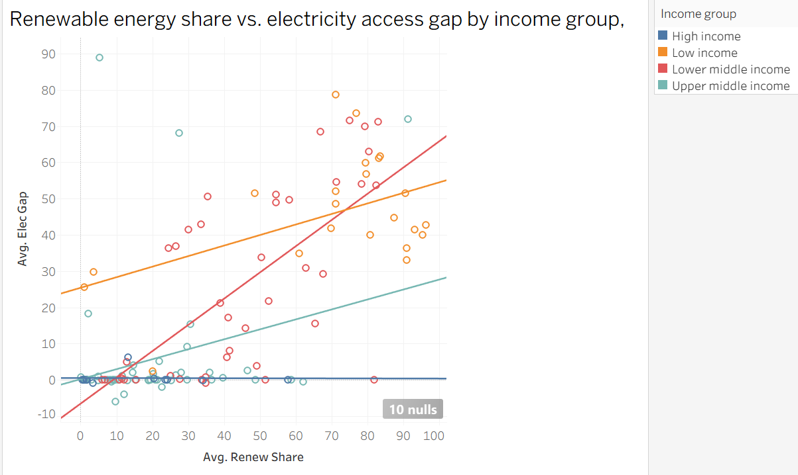

# Does Renewable Energy Reduce Energy Inequality?

**Do countries that use more renewable energy have more equal access to energy between urban and rural populations?** Analysis of World Bank data across 135 countries, 2000 to 2021.

## Key Findings

- **Higher renewable share comes with *larger* access gaps.** Across countries in 2021, renewable share is strongly positively correlated with the urban/rural electricity access gap.
- **Income explains most of this.** Poorer countries have both higher renewable shares and larger gaps. Within income groups, the relationship largely fades.
- **Access became more equal as renewable share fell.** Of 108 countries, 90 narrowed their electricity gap between 2000 and 2021, while 76 saw their renewable share decline.
- **A small gap doesn't always mean equality.** In low-income countries, clean cooking access in 2021 was 13% urban and 0.5% rural: the gap is small because largely no one has access.

## The Biomass Problem

The World Bank's renewable share indicator considers traditional biomass equal to modern renewables like solar and wind. In poorer countries, a high renewable share could be a marker of energy poverty, not clean energy progress. As countries therefore develop, households move from biomass based energy to grid electricity, causing renewable share to fall while access improves.

## What this means for policy

National renewable share is a poor indicator of progress toward energy equity. Policymakers and development agencies wishing to work in this space should:
- Track rural access levels in a direct way
- Measure modern renewable deployment separately from traditional biomass

## Data and Method

- **Source:** World Bank World Development Indicators (accessed September 2026)
- **Sample:** 135 countries, 2000 to 2021 (2,970 country-years), excluding countries with universal rural electricity access
- **Analysis:** distributions, trends by income group, Spearman correlations and linear trends on 2000 to 2021 changes
